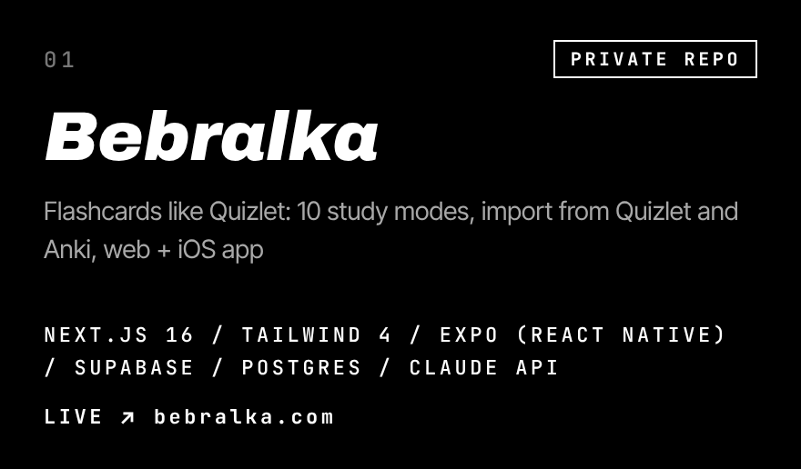
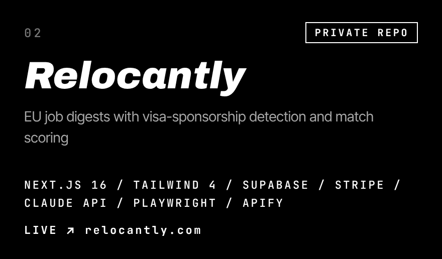
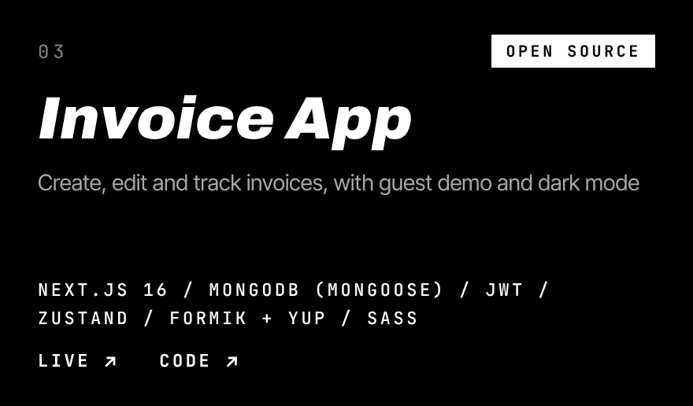
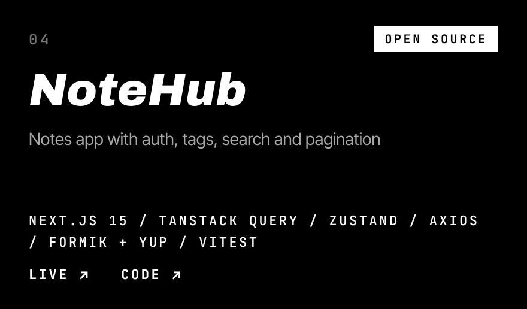
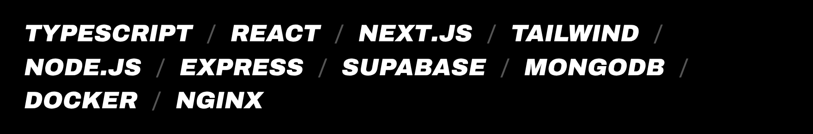

  

## Selected work

  
  

  
  

  
    <b>Bebralka</b> <a href="https://bebralka.com">live</a> &nbsp;·&nbsp;
    <b>Relocantly</b> <a href="https://relocantly.com">live</a> &nbsp;·&nbsp;
    <b>Invoice App</b> <a href="https://invoice-app-tau-liart.vercel.app">live</a> / <a href="https://github.com/merci54/invoice-app">code</a> &nbsp;·&nbsp;
    <b>NoteHub</b> <a href="https://09-auth-woad.vercel.app">live</a> / <a href="https://github.com/merci54/notehub-app">code</a>
  

## Stack

  

## Contact

  
  
  

